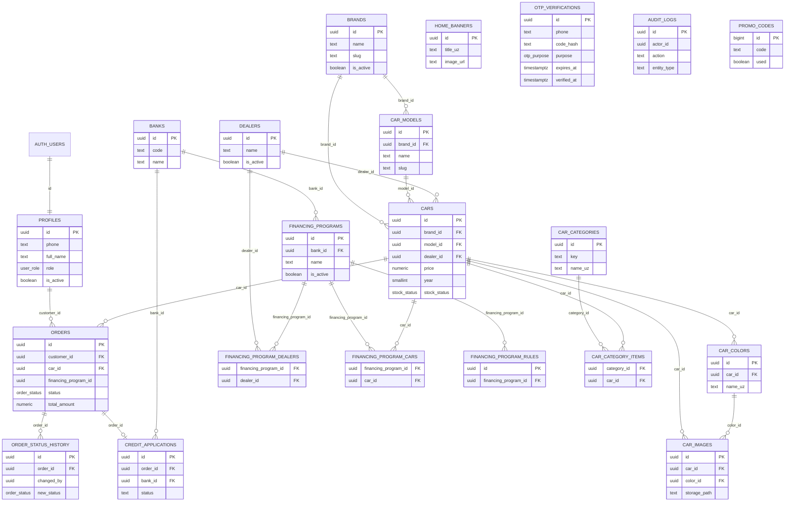

# Cardrive database ER diagram

This diagram documents the **currently observed Production schema**, not the future CRM/used-car schema. It is intentionally limited to relationships verified from the current database and repository migrations. Some later-added fields and relationships need to be reconciled against the migration drift report before being treated as canonical.

## Important notes

- `otp_verifications`, `audit_logs`, and `promo_codes` are operational/security tables; they should not be exposed for direct client CRUD.
- `profiles.id` references `auth.users.id`.
- `credit_applications.order_id` is unique in the original foundation migration.
- `car_category_items` is a many-to-many join table.
- The Production database has 21 public base tables in the inspected schema.
- This is not the target ERD for the future used-car marketplace. The used-car model must be introduced additively and must not overload the curated `cars` catalog.
